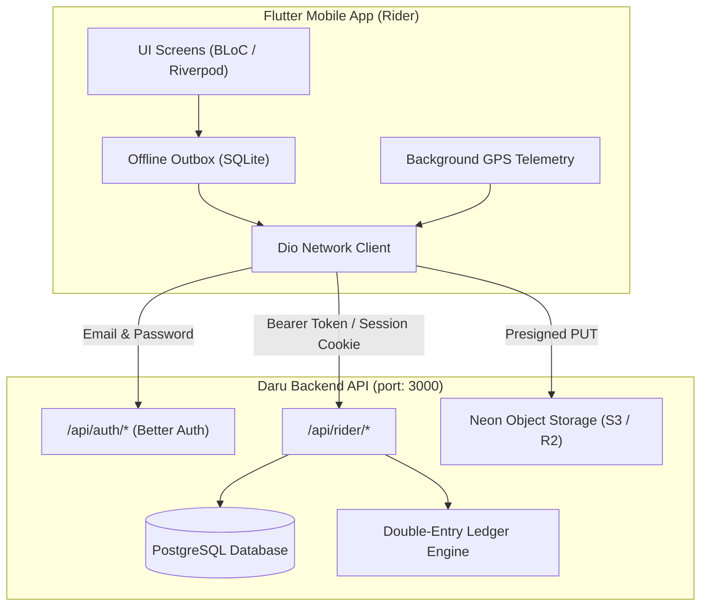
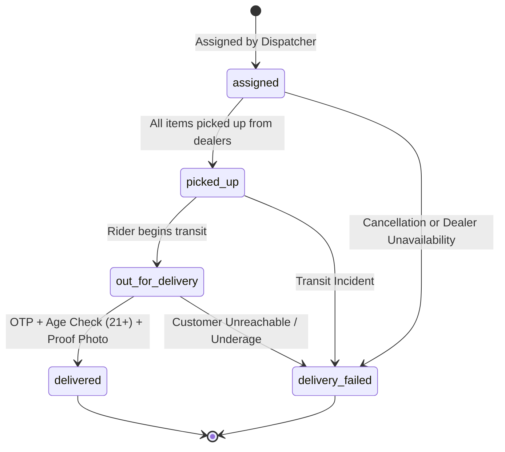
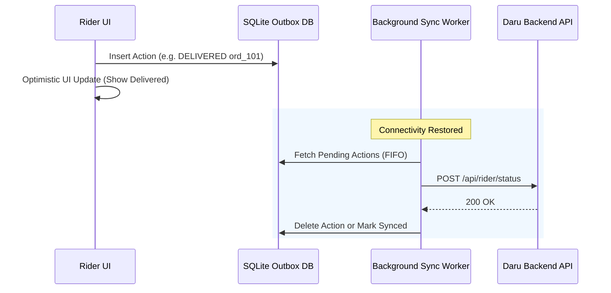

# Daru Fleet — Rider Mobile Application Reference Specification (`RIDER_REF.md`)

> **Target Audience:** Autonomous AI Agents and Mobile Engineers building the standalone **Flutter Rider Mobile Application** (Android & iOS) for the Daru quick-commerce liquor and food delivery network in Nepal.
>
> **Repository Context:** This document mirrors the backend logic implemented in the Daru Next-Gen web monorepo (`src/routes/api/rider/$.ts`, `src/server/riders/*`, `src/server/orders/*`, and `src/server/finance/*`).

---

## Table of Contents

1. [Executive Architecture & System Overview](#1-executive-architecture--system-overview)
2. [Nepal Localization & Monetary Rules](#2-nepal-localization--monetary-rules)
3. [Environment Variables & Configuration](#3-environment-variables--configuration)
4. [Authentication & Session Flow (Better Auth)](#4-authentication--session-flow-better-auth)
5. [Complete REST API Specification](#5-complete-rest-api-specification)
   - [5.1 Dashboard & Portal (`GET /api/rider/portal`)](#51-dashboard--portal-get-apiriderportal)
   - [5.2 Rider Profile (`GET /api/rider/me`)](#52-rider-profile-get-apiriderme)
   - [5.3 Shift History (`GET /api/rider/shifts`)](#53-shift-history-get-apiridershifts)
   - [5.4 Attendance Metrics (`GET /api/rider/attendance`)](#54-attendance-metrics-get-apiriderattendance)
   - [5.5 Shift & Availability Toggle (`POST /api/rider/availability`)](#55-shift--availability-toggle-post-apirideravailability)
   - [5.6 Live GPS Telemetry (`POST /api/rider/live`)](#56-live-gps-telemetry-post-apiriderlive)
   - [5.7 Delivery Status Transition (`POST /api/rider/status`)](#57-delivery-status-transition-post-apiriderstatus)
   - [5.8 Dealer Item Pickup Bill (`POST /api/rider/pickup-bill`)](#58-dealer-item-pickup-bill-post-apiriderpickup-bill)
   - [5.9 Cash Handover / Counter Deposit (`POST /api/rider/cash-deposit`)](#59-cash-handover--counter-deposit-post-apiridercash-deposit)
   - [5.10 Direct Proof & Photo Upload (`POST /api/rider/upload-proof`)](#510-direct-proof--photo-upload-post-apiriderupload-proof)
6. [Core Business Logic & State Machines](#6-core-business-logic--state-machines)
   - [6.1 Order Delivery State Machine](#61-order-delivery-state-machine)
   - [6.2 Sourcing & Multi-Dealer Pickup Sub-workflow](#62-sourcing--multi-dealer-pickup-sub-workflow)
   - [6.3 Age Verification (21+) & Customer OTP Handshake](#63-age-verification-21--customer-otp-handshake)
   - [6.4 Cash-On-Hand (COD) & Double-Entry Accounting](#64-cash-on-hand-cod--double-entry-accounting)
7. [Offline-First Outbox Synchronization (SQLite/Hive)](#7-offline-first-outbox-synchronization-sqlitehive)
8. [Live GPS Tracking & Background Service Rules](#8-live-gps-tracking--background-service-rules)
9. [Complete Dart Data Models](#9-complete-dart-data-models)
10. [Flutter Application Blueprint & Directory Layout](#10-flutter-application-blueprint--directory-layout)
11. [Dio HTTP Client & S3 Upload Implementation](#11-dio-http-client--s3-upload-implementation)
12. [AI Agent Implementation & Testing Roadmap](#12-ai-agent-implementation--testing-roadmap)

---

## 1. Executive Architecture & System Overview

The **Daru Rider App** powers the physical last-mile delivery fleet for Daru in the Kathmandu Valley (Kathmandu, Lalitpur, Bhaktapur) and beyond. The fleet operates under a **hybrid sourcing model**:

- Orders may contain items fulfilled from multiple physical wine/liquor dealers and food hubs.
- Riders are dispatched to pick up individual order items from designated partner dealers, record actual purchase cost bills, assemble the order, and deliver it to the customer.
- Deliveries are governed by legal liquor sale compliance (mandatory 21+ age verification), anti-fraud customer OTP verification, and photo proof-of-delivery.
- Payment is either prepaid (eSewa / Digital Wallet) or Cash on Delivery (COD). Riders carry a running Cash-on-Hand balance and remit counter cash handovers reconciled against the platform's double-entry accounting ledger.



---

## 2. Nepal Localization & Monetary Rules

### 2.1 Currency & Integer Math (CRITICAL)

- **Currency:** Nepalese Rupee (`NPR` / `Rs.`).
- **Internal Storage Unit:** All currency amounts across the backend, APIs, and database are **strictly stored in paisa as 64-bit integers** (`1 NPR = 100 paisa`).
- **Floating Point Prohibition:** **NEVER** use floating-point math for financial operations or ledger balances. Calculate totals, discounts, and deposits in integer paisa.
- **Display Formatting:**
  ```dart
  String formatPaisaToNpr(int paisa) {
    final npr = paisa / 100.0;
    return 'Rs. ${npr.toStringAsFixed(2)}';
  }
  // Example: 150000 paisa -> "Rs. 1500.00"
  ```

### 2.2 Geography & Map Coordinates

- **Primary Operational Area:** Kathmandu Valley, Nepal.
- **Default Fallback Coordinates:** `lat: 27.7172, lng: 85.3240` (Kathmandu City Center).
- **Phone Numbers:** Nepal mobile phone numbers follow the format `98XXXXXXXX` or `97XXXXXXXX` (10 digits) with country code `+977`.

### 2.3 Legal Age Verification

- Under Nepalese regulations, the legal drinking age is **21 years old**.
- When delivering orders containing alcohol (`catalogType == 'liquor'`), the rider is legally obligated to verify that the recipient is 21 or older before handing over the goods.

---

## 3. Environment Variables & Configuration

The Flutter application must configure its network layer via compile-time environment definitions or `.env` files.

### 3.1 Recommended Flutter `.env`

```env
# Backend Base URL
# Android Emulator: use http://10.0.2.2:3000
# iOS Simulator: use http://localhost:3000
# Physical Test Device: use http://<YOUR_LAN_IP>:3000 (e.g. http://192.168.1.100:3000)
# Production: use your production API domain
API_BASE_URL=http://10.0.2.2:3000

# Map Services
GOOGLE_MAPS_API_KEY_ANDROID=AIzaSy...
GOOGLE_MAPS_API_KEY_IOS=AIzaSy...

# Telemetry Intervals
GPS_TRACKING_INTERVAL_SECONDS=15
GPS_DISPLACEMENT_FILTER_METERS=25
```

---

## 4. Authentication & Session Flow (Better Auth)

The backend uses **Better Auth** with the `bearer` and `admin` plugins enabled.

### 4.1 Sign-In Flow

- **Endpoint:** `POST /api/auth/sign-in/email`
- **Request Body:**
  ```json
  {
    "email": "rider@daru.com",
    "password": "Password123!"
  }
  ```
- **Response (200 OK):**
  ```json
  {
    "token": "d8a1c97e-40e1-4cfa-93e1-88f57321a4f0",
    "user": {
      "id": "usr_99812",
      "name": "Bikash Thapa",
      "email": "rider@daru.com",
      "role": "rider",
      "phone": "9841000000",
      "isActive": true
    }
  }
  ```
- **Storage:** Securely store `token` using `flutter_secure_storage`.

### 4.2 Attaching Authentication to Requests

All calls to `/api/rider/*` must provide the session token using **either** of the following headers (or both):

```http
Authorization: Bearer <token>
Cookie: better-auth.session_token=<token>
```

> **Backend Guarantee:** The Daru backend automatically inspects `Authorization: Bearer <token>` and maps it to the active session.

### 4.3 Sign-Out Flow

- **Endpoint:** `POST /api/auth/sign-out`
- **Headers:** `Authorization: Bearer <token>`
- **Response:** `200 OK`

---

## 5. Complete REST API Specification

All rider endpoints are hosted under `/api/rider/*`. All requests and responses use `application/json; charset=utf-8`.

---

### 5.1 Dashboard & Portal (`GET /api/rider/portal`)

The core synchronization endpoint. Call this on app launch, pull-to-refresh, or when returning to foreground.

- **URL:** `/api/rider/portal`
- **Method:** `GET`
- **Headers:** `Authorization: Bearer <token>`
- **Response (200 OK):**

```json
{
  "rider": {
    "id": "rid_01JMWK",
    "userId": "usr_99812",
    "name": "Bikash Thapa",
    "email": "bikash.rider@daru.com",
    "phone": "9841234567",
    "vehicle": "bike",
    "licenseNo": "BA-2-PA-8899",
    "verified": true,
    "available": true,
    "status": "available",
    "lat": 27.7172,
    "lng": 85.324,
    "zone": "Kathmandu Central",
    "cashOnHand": 350000,
    "earnings": 420000,
    "deliveries": 38,
    "rating": 4.9,
    "createdAt": "2026-03-01T08:00:00.000Z"
  },
  "orders": [/* Array of all assigned orders */],
  "activeOrders": [
    {
      "id": "ord_01JN89",
      "number": "ORD-2026-0042",
      "customerId": "usr_c99",
      "customerName": "Aarav Sharma",
      "customerPhone": "9851122334",
      "address": "Jhamsikhel Road, Ward 3",
      "city": "Lalitpur",
      "landmark": "Near Moksh Bar",
      "lat": 27.6765,
      "lng": 85.313,
      "status": "picked_up",
      "paymentMethod": "cod",
      "paymentStatus": "cod_pending",
      "subtotal": 520000,
      "deliveryCharge": 0,
      "discount": 20000,
      "tax": 57522,
      "total": 500000,
      "riderId": "rid_01JMWK",
      "trackingCode": "TRK-98712",
      "deliveryOtp": "4829",
      "deliveryProofPhotoUrl": null,
      "notes": "Please call before arrival",
      "items": [
        {
          "id": "oit_1101",
          "catalogType": "liquor",
          "productId": "prd_jw_black",
          "variantId": "var_750ml",
          "name": "Johnnie Walker Black Label 12Y",
          "variantName": "750ml",
          "sku": "JW-BLK-750",
          "qty": 1,
          "unitPrice": 520000,
          "lineTotal": 520000,
          "dealerId": "dlr_patan_liquor",
          "dealerCostPrice": 470000,
          "actualDealerCostPrice": 470000,
          "dealerBillPhotoUrl": "https://storage.daru.np/assets/delivery-proof/bill-101.jpg",
          "sourcingStatus": "picked_up",
          "dealer": {
            "id": "dlr_patan_liquor",
            "name": "Patan Fine Spirits Store",
            "contact": "9801234567",
            "whatsappNumber": "9801234567",
            "address": "Kumaripati Main Road",
            "city": "Lalitpur",
            "lat": 27.6701,
            "lng": 85.3188,
            "distanceKm": 1.2
          }
        }
      ],
      "events": [
        {
          "id": "ev_01",
          "at": "2026-11-04T07:15:00.000Z",
          "status": "picked_up",
          "note": "Rider picked up all items from dealers",
          "actor": "Bikash Thapa",
          "actorRole": "rider"
        }
      ],
      "createdAt": "2026-11-04T07:00:00.000Z",
      "updatedAt": "2026-11-04T07:15:00.000Z"
    }
  ],
  "completedOrders": [/* Delivered orders */],
  "activeShift": {
    "id": "shf_01K",
    "riderId": "rid_01JMWK",
    "status": "active",
    "startedAt": "2026-11-04T06:00:00.000Z",
    "endedAt": null,
    "durationMinutes": 135,
    "notes": null
  },
  "attendanceStats": {
    "totalShifts": 24,
    "totalDurationMinutes": 11520,
    "avgHoursPerShift": 8.0,
    "daysActive": 22
  },
  "settlements": [/* Rider payouts and commission logs */],
  "stats": {
    "totalAssigned": 4,
    "activeCount": 1,
    "completedCount": 3,
    "cashOnHand": 350000,
    "earnings": 420000,
    "deliveries": 38,
    "rating": 4.9
  }
}
```

---

### 5.2 Rider Profile (`GET /api/rider/me`)

- **URL:** `/api/rider/me`
- **Method:** `GET`
- **Headers:** `Authorization: Bearer <token>`
- **Response (200 OK):**

```json
{
  "rider": {
    "id": "rid_01JMWK",
    "userId": "usr_99812",
    "name": "Bikash Thapa",
    "email": "bikash.rider@daru.com",
    "phone": "9841234567",
    "vehicle": "bike",
    "licenseNo": "BA-2-PA-8899",
    "verified": true,
    "available": true,
    "status": "available",
    "lat": 27.7172,
    "lng": 85.324,
    "zone": "Kathmandu Central",
    "cashOnHand": 350000,
    "earnings": 420000,
    "deliveries": 38,
    "rating": 4.9
  },
  "user": {
    "id": "usr_99812",
    "name": "Bikash Thapa",
    "email": "bikash.rider@daru.com",
    "role": "rider",
    "phone": "9841234567"
  }
}
```

---

### 5.3 Shift History (`GET /api/rider/shifts`)

- **URL:** `/api/rider/shifts?limit=50`
- **Method:** `GET`
- **Headers:** `Authorization: Bearer <token>`
- **Query Params:** `limit` (optional, default: `50`)
- **Response (200 OK):**

```json
{
  "shifts": [
    {
      "id": "shf_01K",
      "riderId": "rid_01JMWK",
      "riderName": "Bikash Thapa",
      "status": "completed",
      "startedAt": "2026-11-03T06:00:00.000Z",
      "endedAt": "2026-11-03T14:30:00.000Z",
      "durationMinutes": 510,
      "notes": null
    }
  ]
}
```

---

### 5.4 Attendance Metrics (`GET /api/rider/attendance`)

- **URL:** `/api/rider/attendance`
- **Method:** `GET`
- **Headers:** `Authorization: Bearer <token>`
- **Response (200 OK):**

```json
{
  "stats": {
    "totalShifts": 24,
    "totalDurationMinutes": 11520,
    "avgHoursPerShift": 8.0,
    "daysActive": 22
  }
}
```

---

### 5.5 Shift & Availability Toggle (`POST /api/rider/availability`)

Switches rider status between Online (`available`) and Offline (`offline`). Automatically starts a new shift in `rider_shifts` when going online, and closes the active shift (calculating elapsed duration) when going offline.

- **URL:** `/api/rider/availability`
- **Method:** `POST`
- **Headers:** `Authorization: Bearer <token>`, `Content-Type: application/json`
- **Request Body:**

```json
{
  "available": true
}
```

- **Response (200 OK):**

```json
{
  "success": true,
  "available": true,
  "status": "available"
}
```

---

### 5.6 Live GPS Telemetry (`POST /api/rider/live`)

Pings rider coordinates to backend for live customer and dispatcher tracking on the operational map.

- **URL:** `/api/rider/live`
- **Method:** `POST`
- **Headers:** `Authorization: Bearer <token>`, `Content-Type: application/json`
- **Request Body:**

```json
{
  "lat": 27.71724,
  "lng": 85.32405,
  "status": "available"
}
```

> `status` can be `"available"`, `"busy"`, or `"offline"`.

- **Response (200 OK):**

```json
{
  "success": true,
  "riderId": "rid_01JMWK",
  "updates": {
    "lat": "27.71724",
    "lng": "85.32405",
    "status": "available",
    "updatedAt": "2026-11-04T08:00:00.000Z"
  }
}
```

---

### 5.7 Delivery Status Transition (`POST /api/rider/status`)

Advances the lifecycle of an order assigned to the rider.

- **URL:** `/api/rider/status`
- **Method:** `POST`
- **Headers:** `Authorization: Bearer <token>`, `Content-Type: application/json`
- **Valid Values for `status`:**
  - `"picked_up"`: All items gathered from dealers; packed and ready for transit.
  - `"out_for_delivery"`: Rider is actively traveling to customer location.
  - `"delivered"`: Successfully handed to customer.
  - `"delivery_failed"`: Unsuccessful attempt.

#### Example A: Successful Delivery with Age Verification & Proof

```json
{
  "orderId": "ord_01JN89",
  "status": "delivered",
  "ageVerifiedAtDelivery": true,
  "deliveryOtp": "4829",
  "proofPhotoUrl": "https://storage.daru.np/assets/delivery-proof/proof-9912.jpg",
  "notes": "Delivered to recipient at front gate"
}
```

#### Example B: Delivery Failed

```json
{
  "orderId": "ord_01JN89",
  "status": "delivery_failed",
  "deliveryFailureReason": "customer_unreachable",
  "notes": "Called 4 times over 15 minutes, gate locked."
}
```

> **Valid `deliveryFailureReason` keys:** `customer_unreachable`, `customer_rejected`, `wrong_address`, `damaged_goods`, `payment_issue`, `prohibited_delivery` (e.g. Underage 21+ check failure).

- **Response (200 OK):**

```json
{
  "success": true,
  "orderId": "ord_01JN89",
  "status": "delivered"
}
```

---

### 5.8 Dealer Item Pickup Bill (`POST /api/rider/pickup-bill`)

When picking up individual items from physical liquor/grocery stores, riders inspect the item, obtain the merchant's physical cash bill, record the actual cost paid, and take a photo of the bill.

- **URL:** `/api/rider/pickup-bill`
- **Method:** `POST`
- **Headers:** `Authorization: Bearer <token>`, `Content-Type: application/json`
- **Request Body:**

```json
{
  "orderId": "ord_01JN89",
  "orderItemId": "oit_1101",
  "actualDealerCostPrice": 470000,
  "dealerBillPhotoUrl": "https://storage.daru.np/assets/delivery-proof/bill-101.jpg"
}
```

> Note: `actualDealerCostPrice` is in integer **paisa** (e.g., Rs. 4,700 = `470000`).

- **Response (200 OK):**

```json
{
  "success": true,
  "orderId": "ord_01JN89",
  "orderItemId": "oit_1101"
}
```

---

### 5.9 Cash Handover / Counter Deposit (`POST /api/rider/cash-deposit`)

When a rider visits the Daru hub or cashier counter to remit accumulated Cash-on-Delivery (COD) cash, this endpoint reduces the rider's `cashOnHand` and automatically executes a double-entry ledger transaction crediting the rider clearing account and debiting the counter cash account.

- **URL:** `/api/rider/cash-deposit`
- **Method:** `POST`
- **Headers:** `Authorization: Bearer <token>`, `Content-Type: application/json`
- **Request Body:**

```json
{
  "amount": 250000,
  "note": "Counter deposit to Cashier Sunil at Thamel Hub"
}
```

> `amount` is in integer **paisa** (e.g. Rs. 2,500.00 = `250000`).

- **Response (200 OK):**

```json
{
  "success": true,
  "handoverId": "rch_99182a",
  "depositedAmount": 250000,
  "remainingCashOnHand": 100000
}
```

- **Error (400 Bad Request):**
  If `amount > rider.cashOnHand`, returns:
  `{ "error": "Deposit amount exceeds cash on hand (Rs. 1000.00)" }`

---

### 5.10 Direct Proof & Photo Upload (`POST /api/rider/upload-proof`)

Generates an S3/R2 presigned upload URL so the mobile app can upload high-resolution delivery photos and dealer bills directly to storage with zero backend CPU/RAM bottleneck.

- **URL:** `/api/rider/upload-proof`
- **Method:** `POST`
- **Headers:** `Authorization: Bearer <token>`, `Content-Type: application/json`
- **Request Body:**

```json
{
  "filename": "camera-capture.jpg",
  "contentType": "image/jpeg"
}
```

- **Response (200 OK):**

```json
{
  "uploadUrl": "https://storage.daru.np/assets/delivery-proof/1741123456-abc.jpg?X-Amz-Signature=...",
  "publicUrl": "https://storage.daru.np/assets/delivery-proof/1741123456-abc.jpg",
  "key": "delivery-proof/1741123456-abc.jpg"
}
```

#### Upload Execution in Flutter:

Use Dio to perform a binary `PUT` directly to `uploadUrl`:

```dart
await dio.put(
  uploadUrl,
  data: imageFileBytes,
  options: Options(
    headers: {
      'Content-Type': 'image/jpeg',
    },
  ),
);
```

Save `publicUrl` and pass it to `/api/rider/status` (`proofPhotoUrl`) or `/api/rider/pickup-bill` (`dealerBillPhotoUrl`).

---

## 6. Core Business Logic & State Machines

### 6.1 Order Delivery State Machine



### 6.2 Sourcing & Multi-Dealer Pickup Sub-workflow

An order can have 1 to 5 items sourced from different dealer shops:

1. **Station Grouping:** The Flutter app should group `order.items` by `dealer.id` or `dealer.name`.
2. **Dealer Navigation:** Rider taps on dealer address/phone to call or navigate via Google Maps.
3. **Item Checkoff:**
   - Rider arrives at dealer, confirms item and quantity.
   - Takes a photo of the cash/credit bill.
   - Inputs the negotiated dealer cost price.
   - Dispatches `POST /api/rider/pickup-bill`.
   - UI marks that item as `picked_up` with a green checkmark.
4. **Order Pickup Confirmation:** Once **all** items in the order have `sourcingStatus == 'picked_up'`, the UI enables the **"Confirm All Picked Up"** action, which calls `POST /api/rider/status` with `status: "picked_up"`.

### 6.3 Age Verification (21+) & Customer OTP Handshake

Before completing delivery:

1. **Alcohol Check:** If any item has `catalogType == 'liquor'`, display an alert requiring the rider to physically check government-issued photo ID (Citizenship, Passport, or Driving License).
2. **Age Toggle:** The delivery button remains disabled until the rider flips the switch:
   `[x] Recipient verified to be 21+ years of age`.
3. **Customer OTP:** The customer receives a 4-digit code in their SMS / App. Rider enters this code into the Flutter app:
   - If configured on the order (`order.deliveryOtp`), backend verifies match.
4. **Photo Proof:** Take a photo of the delivered goods (e.g. at the doorstep or recipient handoff).

### 6.4 Cash-On-Hand (COD) & Double-Entry Accounting

- If `order.paymentMethod == 'cod'`:
  - When the rider marks the order as `delivered`, the backend automatically adds `order.total` (in paisa) to `rider.cashOnHand`.
  - The UI updates the top wallet widget: `Cash on Hand: Rs. X,XXX.XX`.
- **Counter Remittance:**
  - At the end of the shift, the rider enters the physical office / dispatch hub.
  - The cashier counts the physical cash.
  - Rider opens the **"Deposit Cash"** sheet in the Flutter app.
  - Rider enters the amount deposited (defaulting to full cash on hand).
  - Taps **"Submit Deposit"** -> `POST /api/rider/cash-deposit`.
  - The backend verifies balance, posts double-entry journal vouchers to general ledger, and resets `cashOnHand`.

---

## 7. Offline-First Outbox Synchronization (SQLite/Hive)

Kathmandu riders routinely encounter dead zones in basements, dense alleys, or high-rise elevators. The application **must never block or drop state changes** due to connectivity loss.

### 7.1 Architecture Pattern: Local Outbox Queue



### 7.2 Local SQLite Outbox Schema

```sql
CREATE TABLE outbox_actions (
    id TEXT PRIMARY KEY,             -- UUID v4
    action_type TEXT NOT NULL,       -- 'STATUS_UPDATE', 'PICKUP_BILL', 'CASH_DEPOSIT', 'GPS_PING'
    endpoint TEXT NOT NULL,          -- '/api/rider/status'
    payload_json TEXT NOT NULL,      -- Full JSON body
    created_at INTEGER NOT NULL,     -- Timestamp ms
    retry_count INTEGER DEFAULT 0,
    status TEXT DEFAULT 'pending'    -- 'pending', 'syncing', 'failed'
);
```

### 7.3 Sync Worker Rules

1. **FIFO Order:** Synchronize items strictly in order of `created_at`.
2. **Network Detection:** Listen to `connectivity_plus` streams. Trigger sync immediately when connection transitions to WiFi or Cellular.
3. **Exponential Backoff:** If the backend returns `5xx` or connection times out, retry in `2^retries * 2` seconds (max 60s).
4. **4xx Rejections:** If the backend returns `400` or `404` (e.g., order cancelled by admin), mark record as `failed` with error reason and alert rider.

---

## 8. Live GPS Tracking & Background Service Rules

Rider live coordinates enable real-time delivery estimation and ETA updates.

### 8.1 Adaptive Telemetry Frequency

| Rider State                                        | Tracking Frequency | Distance Filter | Battery Profile           |
| :------------------------------------------------- | :----------------- | :-------------- | :------------------------ |
| **Offline**                                        | Disabled (0 pings) | N/A             | Zero Battery Impact       |
| **Online / Available**                             | Every 60 seconds   | 100 meters      | Balanced Power            |
| **Active Delivery (Picked Up / Out for Delivery)** | Every 15 seconds   | 25 meters       | High Precision Navigation |

### 8.2 Android & iOS Permissions Required

- **Android:**
  - `ACCESS_FINE_LOCATION`
  - `ACCESS_COARSE_LOCATION`
  - `ACCESS_BACKGROUND_LOCATION`
  - `FOREGROUND_SERVICE`
  - `FOREGROUND_SERVICE_LOCATION`
- **iOS:**
  - `NSLocationWhenInUseUsageDescription`
  - `NSLocationAlwaysAndWhenInUseUsageDescription`
  - `UIBackgroundModes: ['location', 'fetch']`

---

## 9. Complete Dart Data Models

All models must parse safely from API JSON with null guards.

```dart
// lib/data/models/rider_models.dart

class RiderProfile {
  final String id;
  final String? userId;
  final String name;
  final String email;
  final String phone;
  final String vehicle; // 'bike', 'scooter', 'car'
  final String licenseNo;
  final bool verified;
  final bool available;
  final String status; // 'offline', 'available', 'busy'
  final double lat;
  final double lng;
  final String zone;
  final int cashOnHand; // In paisa
  final int earnings;   // In paisa
  final int deliveries;
  final double rating;

  RiderProfile({
    required this.id,
    this.userId,
    required this.name,
    required this.email,
    required this.phone,
    required this.vehicle,
    required this.licenseNo,
    required this.verified,
    required this.available,
    required this.status,
    required this.lat,
    required this.lng,
    required this.zone,
    required this.cashOnHand,
    required this.earnings,
    required this.deliveries,
    required this.rating,
  });

  factory RiderProfile.fromJson(Map<String, dynamic> json) {
    return RiderProfile(
      id: json['id'] as String,
      userId: json['userId'] as String?,
      name: json['name'] as String? ?? 'Rider',
      email: json['email'] as String? ?? '',
      phone: json['phone'] as String? ?? '',
      vehicle: json['vehicle'] as String? ?? 'bike',
      licenseNo: json['licenseNo'] as String? ?? '',
      verified: json['verified'] == true,
      available: json['available'] == true,
      status: json['status'] as String? ?? 'offline',
      lat: (json['lat'] as num?)?.toDouble() ?? 27.7172,
      lng: (json['lng'] as num?)?.toDouble() ?? 85.3240,
      zone: json['zone'] as String? ?? '',
      cashOnHand: (json['cashOnHand'] as num?)?.toInt() ?? 0,
      earnings: (json['earnings'] as num?)?.toInt() ?? 0,
      deliveries: (json['deliveries'] as num?)?.toInt() ?? 0,
      rating: (json['rating'] as num?)?.toDouble() ?? 5.0,
    );
  }
}

class OrderItemDealerInfo {
  final String id;
  final String name;
  final String contact;
  final String? whatsappNumber;
  final String address;
  final String city;
  final double? lat;
  final double? lng;
  final double? distanceKm;

  OrderItemDealerInfo({
    required this.id,
    required this.name,
    required this.contact,
    this.whatsappNumber,
    required this.address,
    required this.city,
    this.lat,
    this.lng,
    this.distanceKm,
  });

  factory OrderItemDealerInfo.fromJson(Map<String, dynamic> json) {
    return OrderItemDealerInfo(
      id: json['id'] as String,
      name: json['name'] as String? ?? 'Dealer',
      contact: json['contact'] as String? ?? '',
      whatsappNumber: json['whatsappNumber'] as String?,
      address: json['address'] as String? ?? '',
      city: json['city'] as String? ?? '',
      lat: (json['lat'] as num?)?.toDouble(),
      lng: (json['lng'] as num?)?.toDouble(),
      distanceKm: (json['distanceKm'] as num?)?.toDouble(),
    );
  }
}

class OrderItem {
  final String id;
  final String catalogType; // 'liquor' | 'food'
  final String productId;
  final String variantId;
  final String name;
  final String variantName;
  final String sku;
  final int qty;
  final int unitPrice; // Paisa
  final int lineTotal;  // Paisa
  final String? dealerId;
  final int? dealerCostPrice;
  final int? actualDealerCostPrice;
  final String? dealerBillPhotoUrl;
  final String sourcingStatus; // 'pending', 'assigned', 'picked_up', 'unavailable'
  final OrderItemDealerInfo? dealer;

  OrderItem({
    required this.id,
    required this.catalogType,
    required this.productId,
    required this.variantId,
    required this.name,
    required this.variantName,
    required this.sku,
    required this.qty,
    required this.unitPrice,
    required this.lineTotal,
    this.dealerId,
    this.dealerCostPrice,
    this.actualDealerCostPrice,
    this.dealerBillPhotoUrl,
    required this.sourcingStatus,
    this.dealer,
  });

  factory OrderItem.fromJson(Map<String, dynamic> json) {
    return OrderItem(
      id: json['id'] as String,
      catalogType: json['catalogType'] as String? ?? 'liquor',
      productId: json['productId'] as String? ?? '',
      variantId: json['variantId'] as String? ?? '',
      name: json['name'] as String? ?? 'Item',
      variantName: json['variantName'] as String? ?? '',
      sku: json['sku'] as String? ?? '',
      qty: (json['qty'] as num?)?.toInt() ?? 1,
      unitPrice: (json['unitPrice'] as num?)?.toInt() ?? 0,
      lineTotal: (json['lineTotal'] as num?)?.toInt() ?? 0,
      dealerId: json['dealerId'] as String?,
      dealerCostPrice: (json['dealerCostPrice'] as num?)?.toInt(),
      actualDealerCostPrice: (json['actualDealerCostPrice'] as num?)?.toInt(),
      dealerBillPhotoUrl: json['dealerBillPhotoUrl'] as String?,
      sourcingStatus: json['sourcingStatus'] as String? ?? 'pending',
      dealer: json['dealer'] != null
          ? OrderItemDealerInfo.fromJson(json['dealer'] as Map<String, dynamic>)
          : null,
    );
  }
}

class DeliveryOrder {
  final String id;
  final String number;
  final String customerName;
  final String customerPhone;
  final String address;
  final String city;
  final String? landmark;
  final double? lat;
  final double? lng;
  final String status; // 'assigned', 'rider_assigned', 'picked_up', 'out_for_delivery', 'delivered', 'delivery_failed'
  final String paymentMethod; // 'cod', 'esewa', 'card', 'khalti'
  final String paymentStatus;
  final int subtotal;
  final int deliveryCharge;
  final int discount;
  final int total; // In paisa
  final String? deliveryOtp;
  final String? deliveryProofPhotoUrl;
  final String? notes;
  final List<OrderItem> items;
  final DateTime createdAt;

  DeliveryOrder({
    required this.id,
    required this.number,
    required this.customerName,
    required this.customerPhone,
    required this.address,
    required this.city,
    this.landmark,
    this.lat,
    this.lng,
    required this.status,
    required this.paymentMethod,
    required this.paymentStatus,
    required this.subtotal,
    required this.deliveryCharge,
    required this.discount,
    required this.total,
    this.deliveryOtp,
    this.deliveryProofPhotoUrl,
    this.notes,
    required this.items,
    required this.createdAt,
  });

  bool get containsLiquor =>
      items.any((item) => item.catalogType == 'liquor');

  bool get isCod => paymentMethod.toLowerCase() == 'cod';

  factory DeliveryOrder.fromJson(Map<String, dynamic> json) {
    return DeliveryOrder(
      id: json['id'] as String,
      number: json['number'] as String? ?? '',
      customerName: json['customerName'] as String? ?? 'Customer',
      customerPhone: json['customerPhone'] as String? ?? '',
      address: json['address'] as String? ?? '',
      city: json['city'] as String? ?? 'Kathmandu',
      landmark: json['landmark'] as String?,
      lat: (json['lat'] as num?)?.toDouble(),
      lng: (json['lng'] as num?)?.toDouble(),
      status: json['status'] as String? ?? 'assigned',
      paymentMethod: json['paymentMethod'] as String? ?? 'cod',
      paymentStatus: json['paymentStatus'] as String? ?? 'pending',
      subtotal: (json['subtotal'] as num?)?.toInt() ?? 0,
      deliveryCharge: (json['deliveryCharge'] as num?)?.toInt() ?? 0,
      discount: (json['discount'] as num?)?.toInt() ?? 0,
      total: (json['total'] as num?)?.toInt() ?? 0,
      deliveryOtp: json['deliveryOtp'] as String?,
      deliveryProofPhotoUrl: json['deliveryProofPhotoUrl'] as String?,
      notes: json['notes'] as String?,
      items: (json['items'] as List<dynamic>?)
              ?.map((e) => OrderItem.fromJson(e as Map<String, dynamic>))
              .toList() ??
          [],
      createdAt: DateTime.tryParse(json['createdAt'] as String? ?? '') ??
          DateTime.now(),
    );
  }
}

class RiderShift {
  final String id;
  final String riderId;
  final String status; // 'active', 'completed'
  final DateTime startedAt;
  final DateTime? endedAt;
  final int durationMinutes;

  RiderShift({
    required this.id,
    required this.riderId,
    required this.status,
    required this.startedAt,
    this.endedAt,
    required this.durationMinutes,
  });

  factory RiderShift.fromJson(Map<String, dynamic> json) {
    return RiderShift(
      id: json['id'] as String,
      riderId: json['riderId'] as String,
      status: json['status'] as String? ?? 'active',
      startedAt: DateTime.parse(json['startedAt'] as String),
      endedAt: json['endedAt'] != null
          ? DateTime.tryParse(json['endedAt'] as String)
          : null,
      durationMinutes: (json['durationMinutes'] as num?)?.toInt() ?? 0,
    );
  }
}
```

---

## 10. Flutter Application Blueprint & Directory Layout

### 10.1 Recommended Dependencies (`pubspec.yaml`)

```yaml
dependencies:
  flutter:
    sdk: flutter

  # State Management & Architecture
  flutter_bloc: ^8.1.6
  equatable: ^2.0.5

  # Networking & Auth
  dio: ^5.7.0
  flutter_secure_storage: ^9.2.2

  # Offline Storage & Database
  sqflite: ^2.4.1
  path_provider: ^2.1.5
  connectivity_plus: ^6.1.0

  # Device Hardware, Camera & GPS
  geolocator: ^13.0.2
  image_picker: ^1.1.2
  url_launcher: ^6.3.1
  permission_handler: ^11.3.1

  # Maps & Routing
  google_maps_flutter: ^2.10.0

  # UI & Helpers
  intl: ^0.20.1
  lucide_icons: ^0.252.0
  cached_network_image: ^3.4.1
```

### 10.2 Recommended Directory Layout

```text
lib/
├── app.dart
├── core/
│   ├── constants/
│   │   ├── api_endpoints.dart
│   │   └── app_colors.dart
│   ├── network/
│   │   ├── api_client.dart
│   │   ├── auth_interceptor.dart
│   │   └── s3_uploader.dart
│   ├── storage/
│   │   ├── secure_storage.dart
│   │   └── outbox_database.dart
│   └── utils/
│       ├── currency_formatter.dart
│       └── phone_launcher.dart
├── data/
│   ├── models/
│   │   ├── rider_models.dart
│   │   └── outbox_item.dart
│   └── repositories/
│       ├── auth_repository.dart
│       ├── rider_repository.dart
│       └── outbox_repository.dart
├── logic/
│   ├── auth/
│   │   ├── auth_bloc.dart
│   │   └── auth_state.dart
│   ├── portal/
│   │   ├── portal_cubit.dart
│   │   └── portal_state.dart
│   ├── delivery/
│   │   ├── delivery_action_cubit.dart
│   │   └── delivery_action_state.dart
│   └── telemetry/
│       └── location_service.dart
└── presentation/
    ├── screens/
    │   ├── auth/login_screen.dart
    │   ├── home/portal_dashboard_screen.dart
    │   ├── orders/order_detail_screen.dart
    │   ├── orders/dealer_pickup_checklist_screen.dart
    │   ├── orders/complete_delivery_modal.dart
    │   ├── shifts/shift_history_screen.dart
    │   └── cash/cash_deposit_screen.dart
    └── widgets/
        ├── cash_on_hand_card.dart
        ├── order_tile.dart
        └── offline_sync_banner.dart
```

---

## 11. Dio HTTP Client & S3 Upload Implementation

### 11.1 Network Client with Auth Interceptor

```dart
// lib/core/network/api_client.dart
import 'package:dio/dio.dart';
import 'package:flutter_secure_storage/flutter_secure_storage.dart';

class ApiClient {
  static const String baseUrl = 'http://10.0.2.2:3000'; // Or production URL
  final Dio dio;
  final FlutterSecureStorage secureStorage;

  ApiClient({required this.secureStorage})
      : dio = Dio(
          BaseOptions(
            baseUrl: baseUrl,
            connectTimeout: const Duration(seconds: 15),
            receiveTimeout: const Duration(seconds: 15),
            headers: {
              'Content-Type': 'application/json',
              'Accept': 'application/json',
            },
          ),
        ) {
    dio.interceptors.add(
      InterceptorsWrapper(
        onRequest: (options, handler) async {
          final token = await secureStorage.read(key: 'auth_token');
          if (token != null && token.isNotEmpty) {
            options.headers['Authorization'] = 'Bearer $token';
            options.headers['Cookie'] = 'better-auth.session_token=$token';
          }
          return handler.next(options);
        },
        onError: (DioException error, handler) async {
          if (error.response?.statusCode == 401) {
            // Trigger logout or token expiration event
          }
          return handler.next(error);
        },
      ),
    );
  }
}
```

### 11.2 S3 Direct Binary Upload Helper

```dart
// lib/core/network/s3_uploader.dart
import 'dart:io';
import 'package:dio/dio.dart';

class S3Uploader {
  final Dio dio;

  S3Uploader(this.dio);

  Future<String> uploadDeliveryPhoto(File imageFile) async {
    final fileName = imageFile.path.split('/').last;

    // 1. Get presigned upload URL from Daru API
    final presignResponse = await dio.post(
      '/api/rider/upload-proof',
      data: {
        'filename': fileName,
        'contentType': 'image/jpeg',
      },
    );

    final uploadUrl = presignResponse.data['uploadUrl'] as String;
    final publicUrl = presignResponse.data['publicUrl'] as String;

    // 2. Binary PUT file bytes directly to storage
    final bytes = await imageFile.readAsBytes();
    await Dio().put(
      uploadUrl,
      data: Stream.fromIterable([bytes]),
      options: Options(
        headers: {
          'Content-Type': 'image/jpeg',
          'Content-Length': bytes.length,
        },
      ),
    );

    return publicUrl;
  }
}
```

---

## 12. AI Agent Implementation & Testing Roadmap

When assigning an autonomous coding agent to build the Flutter app, instruct it to execute the following phases in sequence:

### Phase 1: Authentication & Storage Setup

- [ ] Initialize Flutter project with defined packages.
- [ ] Implement `ApiClient` with `better-auth` token interceptor and secure persistence.
- [ ] Implement `LoginScreen` with email and password fields.
- [ ] Test login against `POST /api/auth/sign-in/email` and verify bearer session persistence.

### Phase 2: Portal Dashboard & Shift Management

- [ ] Build `PortalDashboardScreen` consuming `GET /api/rider/portal`.
- [ ] Implement online/offline switch dispatching `POST /api/rider/availability`.
- [ ] Display KPI cards: Cash on Hand (in Rs.), Today's Deliveries, Active Orders count.
- [ ] Display Active Shift card with running timer.

### Phase 3: Active Order Details & Sourcing Workflow

- [ ] Build `OrderDetailScreen` displaying delivery location, contact customer button (`tel:98...`), and payment method.
- [ ] Build `DealerPickupChecklistScreen`:
  - Group items by dealer name and address.
  - Camera integration to photograph dealer receipts.
  - Text input for actual merchant cost price.
  - Dispatch `POST /api/rider/pickup-bill`.
  - Mark order as `picked_up` (`POST /api/rider/status`) once all items are collected.

### Phase 4: Delivery Handshake & Age Verification

- [ ] Implement **"Complete Delivery"** modal:
  - Check `order.containsLiquor`: If true, show mandatory **"Verify 21+ Age"** checkbox.
  - Numeric OTP field for customer verification.
  - Camera button for photo proof-of-delivery (upload via `S3Uploader`).
  - Cash collected summary if COD (`Rs. X,XXX.XX`).
  - Dispatch `POST /api/rider/status` (`status: "delivered"`).

### Phase 5: Cash Counter Remittance

- [ ] Build `CashDepositScreen` displaying current `cashOnHand`.
- [ ] Number pad / preset chips (Rs. 1,000 / Rs. 5,000 / All).
- [ ] Note field for Cashier Name / Hub location.
- [ ] Dispatch `POST /api/rider/cash-deposit` and verify updated balance.

### Phase 6: Offline Outbox & GPS Telemetry

- [ ] Implement SQLite `outbox_actions` table.
- [ ] Wrap mutation calls (`status`, `pickup-bill`, `cash-deposit`) in an optimistic local outbox queue.
- [ ] Add `connectivity_plus` sync worker.
- [ ] Setup `geolocator` background tracking dispatching to `POST /api/rider/live`.

---

## 13. Manual Verification Curl Commands

Test these commands against your running backend (`http://localhost:3000`) before running the Flutter app:

```bash
# 1. Sign In
curl -X POST http://localhost:3000/api/auth/sign-in/email \
  -H "Content-Type: application/json" \
  -d '{"email":"rider@daru.com","password":"Password123!"}'

# 2. Get Portal Data
curl -X GET http://localhost:3000/api/rider/portal \
  -H "Authorization: Bearer <TOKEN>"

# 3. Toggle Online
curl -X POST http://localhost:3000/api/rider/availability \
  -H "Authorization: Bearer <TOKEN>" \
  -H "Content-Type: application/json" \
  -d '{"available": true}'

# 4. Ping GPS
curl -X POST http://localhost:3000/api/rider/live \
  -H "Authorization: Bearer <TOKEN>" \
  -H "Content-Type: application/json" \
  -d '{"lat": 27.7172, "lng": 85.3240, "status": "available"}'

# 5. Get Presigned Upload URL
curl -X POST http://localhost:3000/api/rider/upload-proof \
  -H "Authorization: Bearer <TOKEN>" \
  -H "Content-Type: application/json" \
  -d '{"filename": "test.jpg", "contentType": "image/jpeg"}'

# 6. Remit Cash Handover
curl -X POST http://localhost:3000/api/rider/cash-deposit \
  -H "Authorization: Bearer <TOKEN>" \
  -H "Content-Type: application/json" \
  -d '{"amount": 50000, "note": "Counter deposit test"}'
```
